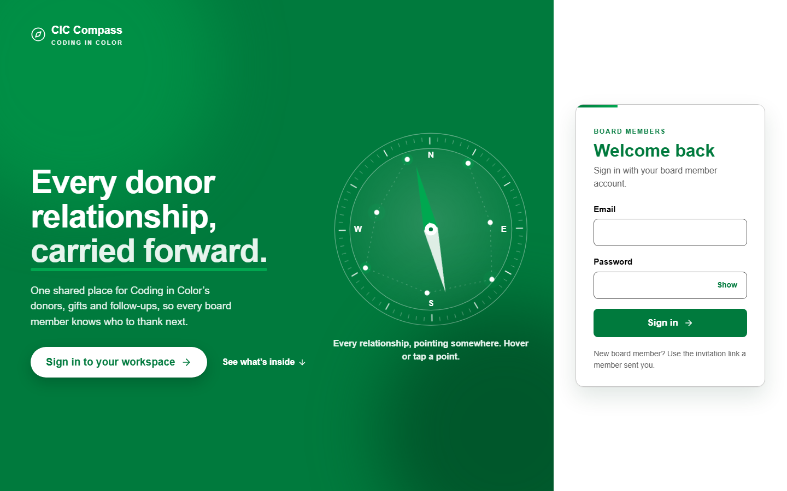
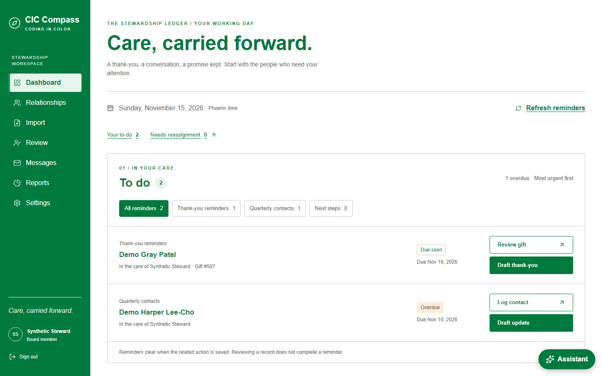
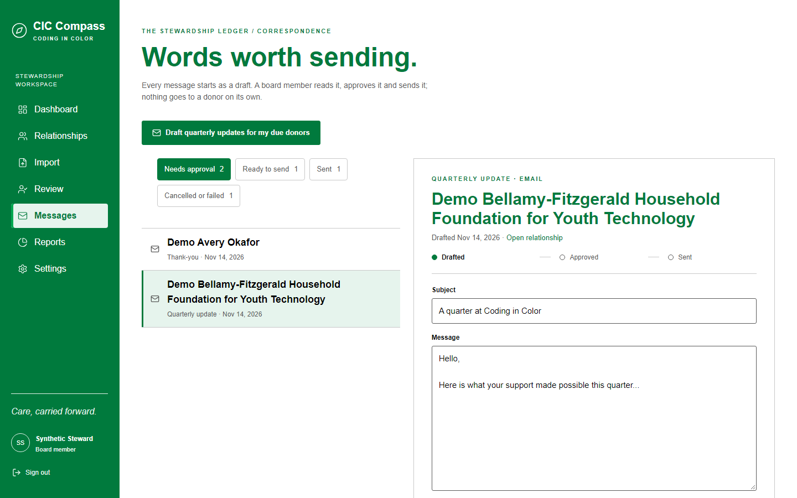
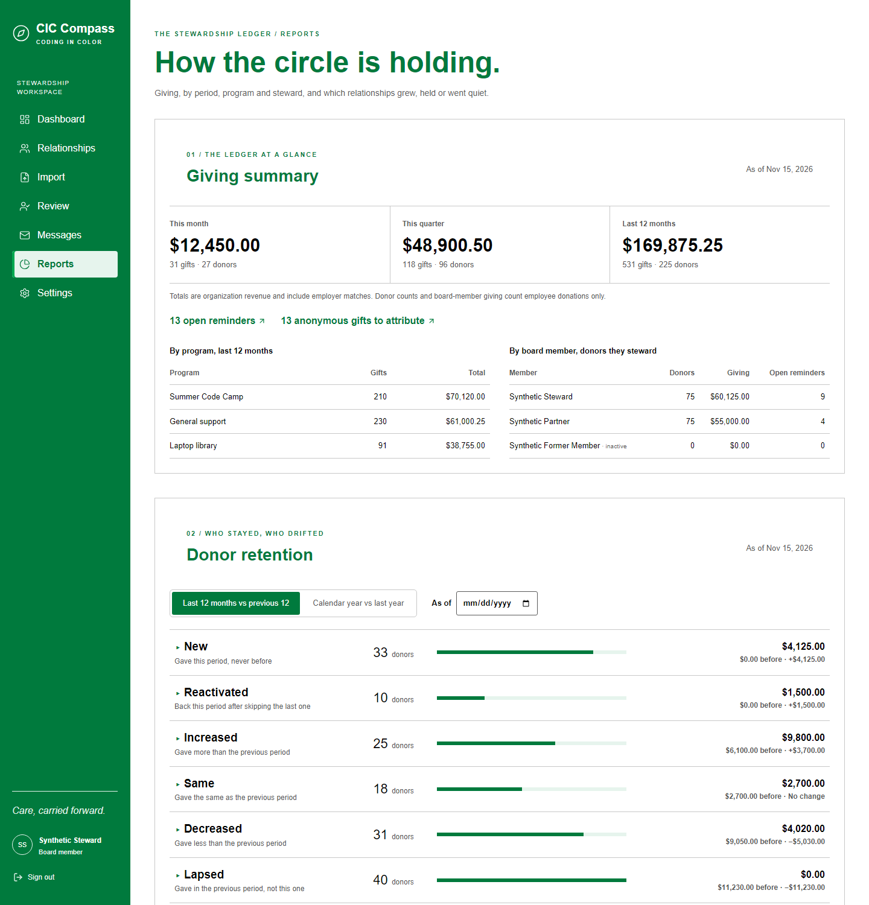
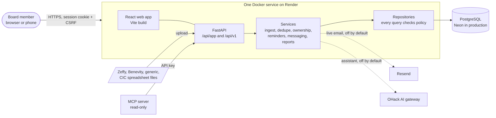

# CIC Compass

**Every donor relationship, carried forward.** A donor and funder stewardship app for [Coding in Color](https://codingincolor.net), built by team Karma.js at Opportunity Hack's ASU Fall Hackathon 2026.

[](https://github.com/2026-Arizona-Opportunity-Hack/Karma.js-CodinginColor/actions/workflows/ci.yml)
[](LICENSE)
[](https://www.ohack.dev/hack/fall-2026)
[](https://www.ohack.dev/project/e26932c0df1b11f189a8dead68f07eb5)



**Live app:** <https://cic-compass.onrender.com> (free hosting; the first visit can take about a minute to wake up)
**Demo video:** added with the hackathon submission

## Contents

- [The problem](#the-problem) · [What it does](#what-it-does) · [How it works](#how-it-works) · [Quick start](#quick-start) · [Test data](#test-data)
- [Tech stack](#tech-stack) · [Status and next steps](#status-and-next-steps) · [Assumptions](#assumptions) · [Security and privacy](#security-and-privacy)
- [Documentation](#documentation) · [Team](#team) · [License](#license)

## The problem

Coding in Color is an Arizona nonprofit that teaches computer science and AI to students, most from historically disadvantaged backgrounds. Its board members are volunteers who raise the money for those programs. Gifts arrive through several platforms (Zeffy, Benevity employer giving, AZ Gives) plus CIC's own donor spreadsheet, so nobody can easily see who gave, who has been thanked, and who has not heard from CIC in months.

CIC Compass pulls those exports into **one de-duplicated donor ledger**, gives each donor an owning board member, and tells each board member **who to thank or contact next**. The app drafts messages, but a person approves and sends every one.

## What it does

| | Feature | Where |
|---|---|---|
| **Import** | Upload Zeffy, Benevity, generic (AZ Gives style) CSV or XLSX files and CIC's donor spreadsheet. Preview counts before committing; the same file or overlapping exports never add a gift twice. | Import |
| **De-duplicate** | Matches donors across sources by email and stored identities. Uncertain matches (shared household email, phone-only match) wait in a review queue for a person to decide. Anonymous employer gifts can be attributed later. | Review |
| **Share the work** | New donors are assigned round-robin across active board members. Reassignment is recorded in an owner history; donors of a deactivated member surface as "Needs reassignment". | Relationships, Dashboard |
| **Know who's next** | A to-do list per board member: thank-yous due, quarterly contacts, next steps, most urgent first. | Dashboard |
| **Approve every message** | Drafts thank-yous and quarterly updates from editable templates. A member edits, approves, then sends (email, dry run by default) or texts from their own phone. | Messages, Settings |
| **Report** | Giving this month, quarter and 12 months; by program and by board member; donor retention (new, reactivated, increased, same, decreased, lapsed) with drill-down. | Reports |
| **Fit CIC's data** | Custom donor and gift fields that can be added, renamed and deactivated without losing values; matching import columns fill them. | Settings → Fields |
| **Govern** | Flat board by default; an optional single super admin is nominated by one member and confirmed by another. Everything important is audit-logged. | Settings |
| **Connect** | An aggregate-only read API with API keys, and a read-only MCP server so a desktop AI assistant can answer "how much did we raise for Summer Camp?". | `/api/v1`, `mcp_server/` |
| **Ask in plain words** | An optional assistant turns one sentence ("Called Maria, follow up in March") into proposed actions that the member confirms. Off unless enabled. | Every page |

| To-do dashboard | Approve and send | Reports and retention |
|---|---|---|
|  |  |  |

## How it works

One Docker image runs a FastAPI backend that serves both the JSON API and the built React app; PostgreSQL holds everything. External services are optional and off by default.



*The backend is the only thing that touches the database, and every repository call checks the authorization policy first.* Details, data flow, sequence and data-model diagrams: [docs/ARCHITECTURE.md](docs/ARCHITECTURE.md).

## Quick start

You need [Docker Desktop](https://www.docker.com/products/docker-desktop/), [uv](https://docs.astral.sh/uv/) (installs Python 3.12 for you) and Node.js 22 or newer.

```bash
git clone https://github.com/2026-Arizona-Opportunity-Hack/Karma.js-CodinginColor.git
cd Karma.js-CodinginColor
cp .env.example .env               # local defaults work as-is; never commit .env
docker compose up -d db            # PostgreSQL 16 on localhost:5432

cd backend
uv sync
uv run alembic upgrade head
DEMO_MODE=true uv run python -m app.cli seed-demo   # 3 demo members + all synthetic files; prints passwords once
uv run uvicorn app.main:app --reload                # API on http://localhost:8000
```

In a second terminal:

```bash
cd frontend
npm ci
npm run dev                        # open http://localhost:5173 and sign in as diana@demo.cic.test
```

Full walkthrough, environment variables, tests and troubleshooting: [docs/SETUP.md](docs/SETUP.md).

## Test data

Everything in this repository is **synthetic**. [`fixtures/`](fixtures/) holds four made-up export files (a CIC-style donor spreadsheet, a Zeffy-like, a Benevity-like and an AZ Gives-like file) generated deterministically by [`fixtures/generate.py`](fixtures/generate.py), plus `manifest.json` with the exact expected results: 225 donors, 531 valid gifts, 19 review items and 14 invalid rows across 659 source rows. The test suite checks the importer against that manifest. Details, schema and how to swap in CIC's real exports: [docs/DATA.md](docs/DATA.md).

## Tech stack

| Layer | Technology |
|---|---|
| Web app | React 19, TypeScript 5.9, Vite, Tailwind CSS 4, TanStack Query, React Router, lucide icons |
| Backend | Python 3.12, FastAPI, Pydantic 2, SQLAlchemy 2, Alembic, Argon2id, openpyxl |
| Database | PostgreSQL 16 (Docker locally, [Neon](https://neon.com) in production) |
| Integrations | Resend email (optional), OHack AI gateway (optional), MCP Python SDK |
| Hosting | One Docker image on [Render](https://render.com); `$0/month` on free tiers ([costs](docs/COSTS.md)) |
| Quality | GitHub Actions: ruff, mypy, pytest on Postgres, tsc, eslint, prettier, build, Docker build, gitleaks |

## Status and next steps

The core loop works end to end on the live app: import → review → assign → remind → draft, approve, send → report. About 400 backend test functions (authorization matrix, importer-versus-manifest and acceptance tests) run on every push, alongside type checks, lint and a container build.

Not finished yet: screens for the funder export, lapsed-donor radar and reminder digest (their APIs exist); program and program-map management (seeded programs are used); donor merge; live email needs CIC's sending domain. The prioritized plan and the handoff to CIC are in [docs/ROADMAP.md](docs/ROADMAP.md).

## Assumptions

- Import layouts are modelled on Zeffy's and Benevity's public documentation, not real CIC files ([sources and confidence](docs/IMPORT_FORMATS.md)).
- CIC's spreadsheet has one row per donor; the program list is a seeded guess; reports use a rolling 12 months.
- Contact details are visible only to the donor's owner (and an active super admin); every member sees gift history.
- Employer matches count as organization revenue but not as the employee's own giving.

All assumptions with their impact and how to confirm them: [docs/DATA.md#assumptions](docs/DATA.md#assumptions).

## Security and privacy

- Argon2id password hashes, hashed session tokens in `HttpOnly` cookies, CSRF checks on every write, login and API rate limits, and security headers with a strict Content Security Policy.
- Authorization lives in one policy module, tested as a matrix of every action × role × ownership × governance state; hiding a button is never the only protection.
- The public API (`/api/v1`) and MCP server return aggregates only; a test fails the build if a donor name, email or phone appears in their schema.
- No secrets in git: configuration comes from environment variables, and CI runs a secret scan.
- Messaging runs in dry-run mode until CIC configures a provider; no message ever goes to a donor without a person's click.

## Documentation

| Document | For |
|---|---|
| [SETUP.md](docs/SETUP.md) | Running it locally, environment variables, tests, deployment, troubleshooting |
| [ARCHITECTURE.md](docs/ARCHITECTURE.md) | How each layer works, with diagrams and a repository map |
| [DATA.md](docs/DATA.md) | Test data, assumptions, and migrating to CIC's real data |
| [ROADMAP.md](docs/ROADMAP.md) | Status, limitations, next steps and the handoff plan |
| [SRS.md](docs/SRS.md) | Requirements with IDs (ING-1, MSG-3, …) referenced throughout |
| [DATA_MODEL.md](docs/DATA_MODEL.md), [API.md](docs/API.md), [API_GUIDE.md](docs/API_GUIDE.md) | Schema rules, API contract, API and MCP how-to with curl examples |
| [IMPORT_FORMATS.md](docs/IMPORT_FORMATS.md) | Source file layouts, with sources and confidence |
| [DECISIONS.md](docs/DECISIONS.md) | Every design decision (D-101 onward) and why |
| [DEPLOY.md](docs/DEPLOY.md), [COSTS.md](docs/COSTS.md) | Render + Neon deployment and monthly costs |
| [BRAND.md](docs/BRAND.md), [CIC_CONTEXT.md](docs/CIC_CONTEXT.md) | CIC brand rules and organizational context |
| [CHANGELOG.md](docs/CHANGELOG.md) | Version history |
| [archive/](docs/archive/) | The hackathon build plan, phase reports and engineering rules |

## Team

Built by **team Karma.js** for Coding in Color's [Donor & Funder Relationship Platform](https://www.ohack.dev/project/e26932c0df1b11f189a8dead68f07eb5) problem statement:

- **Dhaval Tanna** ([@Devils-Ghost](https://github.com/Devils-Ghost))
- **Parthiv Kumbhani** ([@ParthivKumbhanii](https://github.com/ParthivKumbhanii))
- **Param Patel** ([@Param2k23](https://github.com/Param2k23))

Thanks to Greg V and the [Opportunity Hack](https://www.ohack.dev) organizers, mentors, and Coding in Color for the problem and their feedback during the weekend.

## License

[MIT](LICENSE). All data in this repository is synthetic; no real donor or payment information is stored here.
