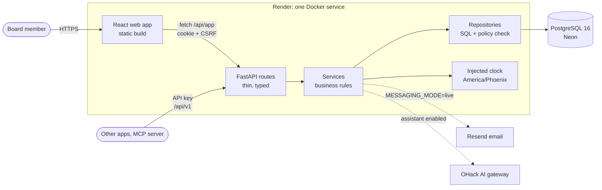
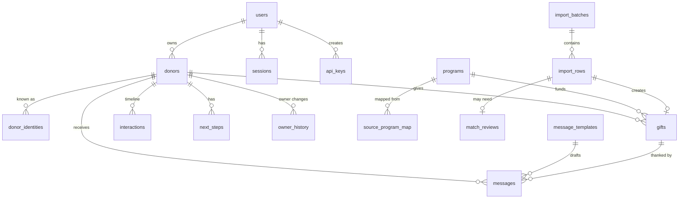
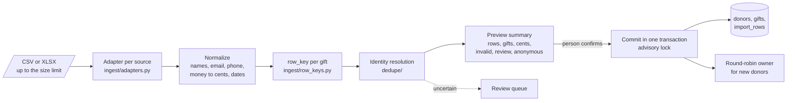
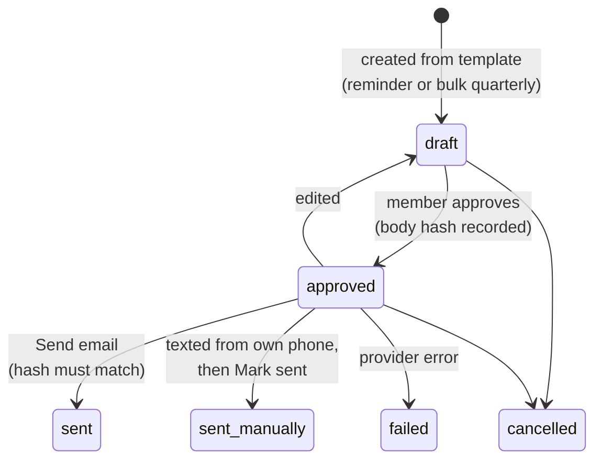
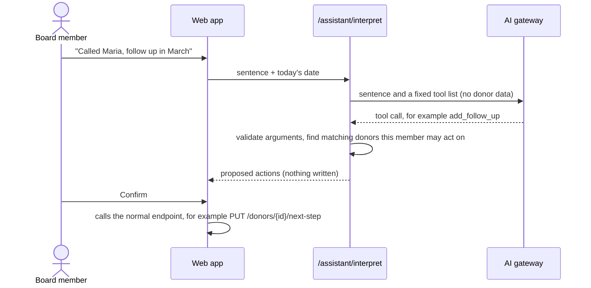
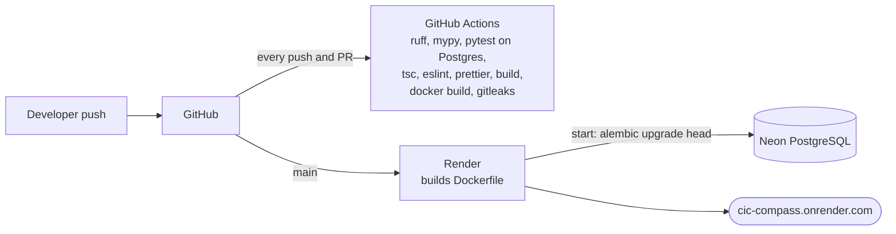

# Architecture

How CIC Compass is put together, layer by layer, with the decisions behind it. Requirement IDs (ING-4, MSG-3, …) refer to [SRS.md](SRS.md); decision IDs (D-127, …) to [DECISIONS.md](DECISIONS.md).

**Contents:** [System overview](#system-overview) · [Repository map](#repository-map) · [Frontend](#frontend) · [Backend and API](#backend-and-api) · [Authorization](#authorization) · [Data layer](#data-layer) · [Import pipeline](#import-pipeline) · [Messaging](#messaging) · [Reports](#reports) · [Assistant](#assistant) · [Public API and MCP](#public-api-and-mcp) · [Infrastructure](#infrastructure)

## System overview



*Notice that every path to the database goes through a repository, and every repository function receives the acting user and checks the policy before querying.*

Design choices that shape everything else:

- **One deployable.** FastAPI serves the API and the built web app from one Docker image (D-102). One service, one URL, same-origin cookies, nothing to configure across sites.
- **Thin routes, rules in services, SQL in repositories.** Routes parse a Pydantic schema, build the actor, call a service and return a schema. That keeps rules testable without HTTP.
- **Money is integer cents everywhere** and only formatted in the browser.
- **Time comes from an injected clock** in Phoenix time, so reminder and retention tests are deterministic.
- **The OpenAPI document is the contract.** `frontend/src/api/types.ts` is generated from it, and CI fails if it drifts.

## Repository map

```
backend/                 FastAPI app, migrations and tests
  app/main.py            app factory: routers, middleware, static web app
  app/settings.py        environment settings (pydantic-settings)
  app/cli.py             setup, superadmin, apikey, seed-demo, reset-demo
  app/authz/             Actor and the single authorization policy
  app/routes/            app_*.py for /api/app (session), v1/ for /api/v1 (API key)
  app/services/          ingest, dedupe, ownership, reminders, messaging, reports,
                         fields, governance, members, apikeys, assistant, ai, demo
  app/repos/             all SQL; every function takes the Actor
  app/schemas/           request and response models (the API contract)
  app/db/models/         SQLAlchemy tables
  alembic/versions/      migrations 0001 to 0006
  tests/                 unit/, integration/, authz/ (policy matrix)
frontend/                React web app (Vite)
  src/pages/             one file per screen
  src/components/        shared components (layout, sheets, compass, assistant)
  src/hooks/             TanStack Query hooks, one per resource
  src/api/               fetch client with CSRF, generated types.ts and openapi.json
  tests/                 browser checks with mocked API responses
mcp_server/              read-only MCP server over /api/v1
fixtures/                synthetic import files, generator and manifest
docs/                    documentation (this folder); archive/ holds build-process notes
Dockerfile, render.yaml  single-image build and Render blueprint
docker-compose.yml       local PostgreSQL
.github/workflows/       CI and PR checks
```

## Frontend

**Purpose:** the board member's workspace. Works from 390 px phones to desktops, keyboard-accessible, in CIC's brand ([BRAND.md](BRAND.md)).

| Screen | Route | File | Main API calls |
|---|---|---|---|
| Sign-in landing | `/login` | `pages/LoginPage.tsx`, `components/CompassScene.tsx` | `POST /auth/login`, `GET /auth/me` |
| Dashboard (to-do) | `/` | `pages/DashboardPage.tsx` | `GET /reminders`, `POST /donors/{id}/messages` |
| Relationships | `/donors` | `pages/DonorsPage.tsx` | `GET /donors` (My/All, search, filters) |
| Donor dossier | `/donors/:id` | `pages/DonorDetailPage.tsx` | donor, timeline, owner history, interactions, next step, funder export |
| Import | `/import` | `pages/ImportPage.tsx`, `components/ImportWorkspace.tsx` | `POST /imports/preview`, `POST /imports/{id}/commit` |
| Review | `/review` | `pages/ReviewPage.tsx` | `GET /reviews`, `POST /reviews/{id}/decide`, `POST /gifts/{id}/attribute` |
| Messages | `/messages` | `pages/MessagesPage.tsx` | `GET /messages`, approve, send, mark-sent, cancel |
| Reports | `/reports` | `pages/ReportsPage.tsx` | `GET /reports/summary`, `GET /reports/retention` |
| Settings | `/settings`, `/settings/fields`, `/settings/api-keys` | `pages/SettingsPage.tsx` and siblings | members, governance, templates, fields, API keys |

- **State:** server state only, through TanStack Query (`src/hooks/`). Writes show the server's response, never an optimistic guess, and invalidate the affected queries.
- **Auth:** `Layout.tsx` calls `GET /auth/me` and redirects to `/login` (remembering the page) when signed out. The fetch client (`src/api/client.ts`) echoes the `cic_csrf` cookie as `X-CSRF-Token` on every write.
- **Privacy in the browser:** when the API hides a donor's contact details, the hook also drops them from the query cache, so they never reach the DOM.
- **Styling:** Tailwind with theme tokens in `src/index.css`; page-level CSS beside each page. Motion respects `prefers-reduced-motion`.

## Backend and API

**Purpose:** owns every rule and every byte of data. Python 3.12, FastAPI, SQLAlchemy 2, Alembic.

The app API lives under `/api/app` (session cookie + CSRF). Interactive documentation is served at `/api/docs`. The full contract is in [API.md](API.md); the main groups:

| Group | Endpoints (method and path under `/api/app`) | Purpose |
|---|---|---|
| Auth | `POST /auth/login`, `POST /auth/logout`, `GET /auth/me` | Sessions, CSRF cookie |
| Donors | `GET/POST /donors`, `GET/PATCH/DELETE /donors/{id}`, `GET /donors/{id}/timeline`, `POST /donors/{id}/gifts`, `POST /donors/{id}/interactions`, `PUT /donors/{id}/next-step`, `POST /next-steps/{id}/done` | Directory, dossier, manual entry (soft delete) |
| Imports | `POST /imports/preview`, `POST /imports/{id}/commit`, `POST /imports/{id}/reverse`, `GET /imports`, `GET /reviews`, `POST /reviews/{id}/decide`, `GET /gifts/unattributed`, `POST /gifts/{id}/attribute` | Upload → preview → commit; identity review |
| Ownership | `GET /reminders`, `GET /reminders/needs-reassignment`, `POST /donors/{id}/reassign`, `GET /donors/{id}/owner-history` | To-do list and reassignment |
| Messages | `POST /donors/{id}/messages`, `POST /messages/draft-quarterly`, `GET /messages`, `PATCH /messages/{id}`, `POST /messages/{id}/{approve,send,mark-sent,cancel}`, `POST /digest/send` | Draft → approve → send |
| Reports | `GET /reports/summary`, `GET /reports/retention`, `GET /reports/lapsed`, `POST /reports/lapsed/draft`, `GET /reports/funder/{donor_id}` | Dashboards, retention, funder packet (HTML/CSV) |
| Members and governance | `GET /members`, `POST /members/invite`, `POST /members/{id}/deactivate`, `POST /members/{id}/move-donors`, `GET /governance`, nominations, `PUT /governance/scope`, `DELETE /governance/super-admin` | Board membership and the optional super admin |
| Settings | `GET/PUT /templates`, `GET/POST/PATCH/DELETE /fields`, API keys, program outcomes | Configuration |
| Assistant | `POST /assistant/interpret` | Sentence → proposed actions |

Ten routes are still contract stubs that answer **501 Not Implemented** honestly: `GET/PUT /settings`, programs, program map, `POST /demo/reset` and donor merge. See [ROADMAP.md](ROADMAP.md).

Errors are typed (`NotFound`, `Forbidden`, `Conflict`, `Invalid`, …) and mapped centrally to 404/403/409/400 with a JSON body `{"error": {"code", "message"}}`. A middleware adds security headers (strict CSP, frame-ancestors none) and per-client rate limits.

## Authorization

All decisions go through `backend/app/authz/policy.py`. A route never decides on its own, and hiding a button in the UI is never the protection.

- **Every member** sees every donor and their gift history (D-104).
- **Contact details and notes** (email, phone, notes, contact-type custom fields) are visible only to the donor's owner and to an active super admin. Others get `null` with a hint to contact the owner.
- **Acting on a donor** (log contact, draft a message, edit) requires ownership, or the active super admin.
- **Governance:** flat by default. A super admin needs one member's nomination and a *different* member's confirmation, and only the super admin can remove the role. API keys can never perform governance actions.
- `tests/authz/` runs the policy as a table: every action × role × ownership × governance state, allowed and denied.
- An audit-coverage test checks that every listed action writes to `audit_log`.

## Data layer

PostgreSQL 16, accessed only through `backend/app/repos/`. Schema rules, constraints and indexes are specified in [DATA_MODEL.md](DATA_MODEL.md); migrations are in `backend/alembic/versions/`.



*Notice that a gift points back to the import row that created it, so every number in the app can be traced to a line in a source file.*

| Table group | Tables |
|---|---|
| People and access | `users`, `sessions`, `invites`, `governance`, `super_admin_nominations`, `api_keys`, `audit_log` |
| Donors and gifts | `donors`, `donor_identities`, `gifts`, `programs`, `source_program_map`, `program_outcomes`, `field_definitions` |
| Imports | `import_batches`, `import_rows`, `match_reviews` |
| Relationship work | `interactions`, `next_steps`, `owner_history`, `messages`, `message_templates`, `digest_runs`, `app_settings` |

Rules enforced by the database, not only by code:
- one live gift per `row_key`;
- one committed file per source and hash;
- `net = gross - fee`;
- USD only;
- message approval columns consistent with status;
- one open draft per donor and kind;
- at most one super admin.

Nothing is hard-deleted: donors and gifts are soft-deleted, and messages are cancelled.

## Import pipeline



1. **Adapters** (`services/ingest/adapters.py`) turn each physical row of a `spreadsheet`, `zeffy`, `benevity` or `generic` file into one `IncomingRow`: a donor, zero or more gifts, or a reason it is invalid. Column layouts are the assumed ones in [IMPORT_FORMATS.md](IMPORT_FORMATS.md). Columns matching an active custom field fill it; unknown columns are listed as ignored.
2. **Normalizers** clean the values: lowercase emails, E.164-style phones, NFKC names without honorifics, `$1,234.50` to `123450` cents, ISO, US and Excel-serial dates.
3. **Row keys** make re-uploads idempotent. A gift with a platform transaction id is keyed on it. Otherwise the key is source + donor + date + amount + occurrence within the file, so two genuine identical gifts stay two.
4. **Identity resolution** matches by stored identities (normalized email, platform contact id) and never by name alone. Shared household emails, phone-only matches and name conflicts go to the **review queue**.
5. **Preview** reports physical rows and gift counts separately, because one Benevity row can carry a donation *and* an employer match. Totals must reconcile before commit is allowed. Previews live in memory for 20 minutes.
6. **Commit** re-validates everything under a PostgreSQL advisory lock in one transaction. It writes the batch, rows, gifts, new donors and their identities, assigns new donors round-robin to the lightest active member, and records owner history and an audit entry. A committed batch can be **reversed** (soft-delete its gifts and any donors it alone created).

Gifts older than the cutoff (default 60 days) are marked `assumed_thanked`, so loading years of history does not create hundreds of thank-you reminders.

## Messaging



- Templates (`message_templates`) hold merge fields: `{first_name}`, `{gift_amount}`, `{gift_date}`, `{program}`, `{owner_name}` and `{org_name}`. Pre-filled amounts use the donor's own gift, never an employer match (D-127).
- The state machine is enforced in code **and** by a database check. Send is rejected from any state but `approved`, and approval and send are separate clicks.
- `MESSAGING_MODE=dry_run` (default) records the send and delivers nothing; the UI labels it "Dry run". `live` sends through Resend.
- Every send writes send history, a timeline interaction and an audit entry, and that clears the matching reminder.
- Reminders are **derived**, not stored (`services/reminders/`): thank-you due, quarterly contact due, next step due, needs reassignment.

## Reports

- **Summary (RPT-1):** totals for this month, this quarter and 12 months; by program; by board member; open reminders; unattributed gifts.
- **Retention (RPT-2):** rolling (current 365 days versus the previous 365) or calendar year. Classes: new, reactivated, increased, same, decreased, lapsed, each with a donor drill-down.
- **Employer matches** are organization revenue in totals but excluded from employee giving and retention (D-127).
- **Funder packet:** printable HTML or CSV of a donor's giving with program outcomes. CSV cells are neutralized against spreadsheet formula injection.
- `/api/v1` and the app's Reports page share the same queries (`services/reports/`), so numbers always agree.

## Assistant

Optional, off unless `AI_GATEWAY_*` is configured and the `assistant_enabled` setting is true (D-145).



- Three tools only: log a contact, add a follow-up, draft a thank-you (`services/assistant/tools.py`).
- Speech-to-text runs in the browser, and no audio is stored.
- The donor list is never sent to the model, and the sentence is not logged; the audit entry records only the proposed tool names.

## Public API and MCP

- `/api/v1` is read-only and **aggregate-only**: summary, retention, totals by period, program and board member, recent activity, and health.
- Access needs an API key (`Authorization: Bearer cic_live_…`), stored only as a SHA-256 hash. Keys expire, are rate-limited to 60 requests a minute, and can be revoked. A schema test fails the build if a donor name, email, phone or id appears in any response.
- **Full-access keys** (`cic_full_…`) let another app call `/api/app` as the member who created them, excluding governance and key management. Every action they take is audited. See [API_GUIDE.md](API_GUIDE.md#10-full-access-keys).
- `mcp_server/` is a small stdio MCP server exposing six read-only tools over `/api/v1`, so a desktop AI assistant can answer questions about CIC's giving. Setup: [mcp_server/README.md](../mcp_server/README.md).

## Infrastructure



- `Dockerfile` builds the web app with Node 22, then a Python 3.12 slim image with locked dependencies, running as a non-root user.
- On start the container runs migrations, then one uvicorn process. One process is required because import previews are held in memory.
- `render.yaml` defines the service (free plan for the hackathon). Secrets (`DATABASE_URL`, `RESEND_API_KEY`) live in Render's dashboard only.
- Costs: $0/month on free tiers, about $7/month for an always-on Render Starter instance ([COSTS.md](COSTS.md)). Deploy steps: [DEPLOY.md](DEPLOY.md).
