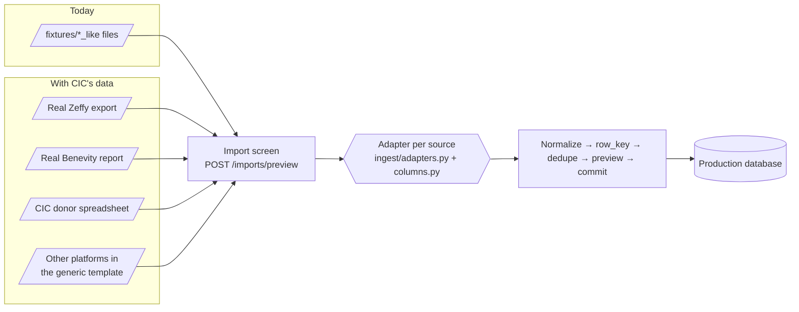

# Data: test data, assumptions and moving to real data

**Contents:** [Where the test data comes from](#where-the-test-data-comes-from) · [What it looks like](#what-it-looks-like) · [How to load it](#how-to-load-it) · [Assumptions](#assumptions) · [Migrating to CIC's real data](#migrating-to-cics-real-data) · [Privacy and security for real data](#privacy-and-security-for-real-data)

## Where the test data comes from

**Every record in this repository is synthetic.** No real donor, gift or payment data exists anywhere in the repository, the tests or the screenshots.

- **Source:** [`fixtures/generate.py`](../fixtures/generate.py), a deterministic generator (seed `20261114`). Running it twice produces byte-identical files.
- **Shape:** the column layouts follow the publicly documented Zeffy and Benevity formats and CIC's described spreadsheet ([IMPORT_FORMATS.md](IMPORT_FORMATS.md) cites every source and how sure we are). None of the files is a real platform export, and they are named `*_like` for that reason.
- **Designed outcomes:** every row is generated together with the outcome it should produce (new donor, linked to an existing donor, needs review, anonymous, invalid). [`fixtures/manifest.json`](../fixtures/manifest.json) records the exact expected results.
- **Independent check:** `backend/tests/integration/test_fixtures.py` recomputes the manifest from the files with its own parser and resolver, and the importer's acceptance test checks the real importer against it.
- **License:** MIT, like the rest of the repository.

To regenerate: `python fixtures/generate.py` (or `--out DIR` to write elsewhere).

## What it looks like

Import the files in this order (it is the order the manifest assumes):

| File | Represents | Physical rows | Valid gifts | Invalid rows | New donors |
|---|---|---|---|---|---|
| `synthetic_cic_spreadsheet.xlsx` | CIC's donor list: people, organizations and funders; typos, shared household emails, missing emails | 129 | 0 (donors only) | 0 | 126 |
| `synthetic_zeffy_like.csv` | 30 months of Zeffy payments, campaigns mapping to programs, monthly donors; refunded, non-USD, failed, bad-amount and bad-date rows | 410 | 403 | 7 | 60 |
| `synthetic_benevity_like.csv` | Employer-giving disbursements: donation and employer match on the same row, anonymous donors, donors overlapping Zeffy with work emails | 80 | 91 | 4 | 26 |
| `synthetic_generic_azgives_like.csv` | AZ Gives-style gifts in our generic template | 40 | 37 | 3 | 13 |
| **Total** | | **659** | **531** | **14** | **225** |

After all four imports there are **19 review items** (household emails, phone-only matches, name conflicts) and **13 anonymous Benevity gifts** waiting to be attributed. Gross gifts total $129,437.50: $128,425.00 in donations and $1,012.50 in employer matches. Retention as of 2026-11-15 (rolling) is 33 new, 10 reactivated, 25 increased, 18 same, 31 decreased and 40 lapsed.

Columns per source are in [IMPORT_FORMATS.md](IMPORT_FORMATS.md). For example, the generic template:

| Date | Amount | Platform | Donor name | Email | Campaign | Transaction ID |
|---|---|---|---|---|---|---|
| 2026-04-02 | 250.00 | azgives | Jordan Example | jordan@example.org | Summer Camp | AZG-10021 |

Features that rely on this data: the import screen and review queue, the to-do list (thank-yous and quarterly contacts), the messages drafts, reports and retention, and the acceptance tests.

## How to load it

```bash
cd backend
DEMO_MODE=true uv run python -m app.cli seed-demo
```

This creates three demo members and imports all four files through the real importer, printing `imported <file>: <n> new donors, <n> gifts` for each. You can also upload the files yourself on the **Import** screen in the order above. Full steps: [SETUP.md](SETUP.md#load-test-data).

## Assumptions

Each assumption is something the code depends on that CIC has not yet confirmed.

| # | Assumption | Why we made it | What depends on it | Risk if wrong | How to validate with CIC |
|---|---|---|---|---|---|
| A1 | Zeffy and Benevity file layouts match their public documentation | No real export was available during the weekend | `services/ingest/adapters.py`, `columns.py` | A real file fails preview with "missing column" | Ask CIC for one exported header row from each platform |
| A2 | CIC's spreadsheet has one row per donor (person, organization or funder) | CIC described it that way | Spreadsheet adapter; it never creates gifts | Gifts kept in the spreadsheet would be ignored | Look at CIC's real sheet together |
| A3 | Program list: AI Academy, K12 Program, Summer Camp, Day of Compute, General; campaign names map to programs | Seeded from CIC's materials | Reports by program, funder packet, `{program}` merge field | Gifts land in "General" | Confirm the list and the campaign-to-program mapping ([CIC_CONTEXT.md](CIC_CONTEXT.md) lists six programs) |
| A4 | Reports use a rolling 12 months; calendar year is optional | Most useful default without a fiscal year | Retention, summary | Board compares different periods | Ask for CIC's fiscal year |
| A5 | Contact details (email, phone, notes) are visible only to the donor's owner and an active super admin | Privacy by default (DON-3) | Policy, every donor screen, the API | Members cannot reach donors they don't own | Confirm with CIC's board |
| A6 | Employer matches are organization revenue but not the employee's own giving | CIC confirmed during the weekend (D-127) | Totals, retention, message amounts | Thank-you amounts off | Already confirmed; re-check yearly |
| A7 | Identities match on normalized email and platform contact id, never on name alone | Wrong merges are worse than duplicates | Dedupe and the review queue | More review items than expected | Watch review volume on the first real import |
| A8 | Gifts older than 60 days at import are already thanked | Loading history should not flood the to-do list | Thank-you reminders | Old unthanked gifts stay hidden | Confirm the cutoff (`import_cutoff_days` in `app_settings`) |
| A9 | Amounts are USD; other currencies are rejected | CIC operates in Arizona | Normalizers | Rare non-USD gifts skipped | Ask whether any non-USD gifts occur |
| A10 | Volumes stay small (thousands of donors, files up to 5 MB and 20,000 rows) | A local nonprofit's scale | Upload limits, single-process design | Very large files are refused | Check the largest real export |
| A11 | No message goes to a donor without a person's click; email stays in dry run until CIC configures a sending domain | The brief requires it | Messaging | None while dry run is on | CIC picks a sending domain for live email |

## Migrating to CIC's real data

**Short version: easy.** The app has no test-data shortcut. Synthetic files go through the same upload, preview and commit as real exports. The swap point is the file you upload, plus one adapter per source if a real layout differs from our assumption.



*Notice that the only component that changes with real files is the adapter's column mapping; everything after it is source-independent.*

### Data contract

Each adapter must produce, per source row, these fields (`IncomingRow` in `services/ingest/adapters.py`):

| Field | Type | Required | Notes |
|---|---|---|---|
| `donor.display_name` | text | yes, unless anonymous | person or organization name |
| `donor.first_name`, `last_name`, `organization` | text | no | split from the name when absent |
| `donor.kind` | `person`, `organization` or `funder` | no | default `person` |
| `donor.email`, `donor.phone` | text | no | normalized; contact details (owner-only) |
| `donor.zeffy_contact` | text | no | platform contact id; becomes a stable identity |
| `gift.gift_date` | date | yes | ISO, `MM/DD/YYYY`, `M/D/YY` or Excel serial |
| `gift.gross_cents`, `fee_cents`, `net_cents` | integer cents | yes | `net = gross - fee`; dollars converted with half-up rounding |
| `gift.source_txn_id` | text | strongly recommended | makes re-uploads idempotent |
| `gift.campaign_name` | text | no | mapped to a program |
| `gift.is_matching_gift` | boolean | no | employer match rows |
| `custom.*` | per field type | no | any column whose header matches an active custom field |

### What to change, step by step

1. **Get one real file per source** and try it on the Import screen. Preview never writes anything, so this is safe on production.
2. **If a column is reported missing,** change the header that source's adapter reads in `backend/app/services/ingest/adapters.py`, and the same name in that source's `KNOWN` set in `backend/app/services/ingest/columns.py` (which keeps it out of the "ignored columns" list).
3. **Add a test** to `backend/tests/unit/test_ingest_adapters.py` with the real header row and a few made-up values, and the `IncomingRow` you expect.
4. **Update programs** so real campaigns map to real programs. The program and program-map endpoints are still stubs (see [ROADMAP.md](ROADMAP.md)), so for now edit the seed in the migration or the `programs` and `source_program_map` tables directly.
5. **For extra columns CIC wants to keep** (for example "Board member" or "T-shirt size"), create a custom field in **Settings → Fields** with the same name, and matching import columns fill it automatically.
6. **Create real board members** with `uv run python -m app.cli setup` against the production database ([DEPLOY.md](DEPLOY.md)).
7. **Import in order:** the donor spreadsheet first, then gift files oldest to newest. Resolve the review queue.
8. **Update `IMPORT_FORMATS.md`:** mark each layout "verified" with the date.

| Component | Ease | Why | Effort |
|---|---|---|---|
| CIC donor spreadsheet | Easy | Our own template; only header aliases may change | under 1 hour |
| Generic template (AZ Gives, United Way, others) | Easy | CIC fills our documented columns | none (fill the template) |
| Zeffy payments export | Moderate | Exact headers, date format and amount units are undocumented | 1 to 3 hours with one sample |
| Benevity disbursement report | Moderate | Glossary documented, exact headers not | 1 to 3 hours with one sample |
| Programs and campaign mapping | Moderate | Needs CIC's real list; no UI yet | 1 to 2 hours |
| Zeffy API pull (instead of uploads) | Hard | New scheduled job; API documented in IMPORT_FORMATS.md | 1 to 2 days |

### Validating a real import

1. Compare the preview totals (rows, gifts, dollars) with the platform's own report for the same period.
2. Upload the same file again: the preview must show zero new gifts.
3. Spot-check five donors across sources: one donor, no duplicates, correct owner.
4. Open **Reports**: totals by program should match CIC's books for the same months.
5. Re-run the checks in [SETUP.md](SETUP.md#tests-and-checks) after any adapter change.

## Privacy and security for real data

- **Never commit real exports.** Keep them out of the repository; `.gitignore` covers `.env` and local setup files, not data files you save in the repo folder.
- **Contact details are owner-only** in the app and in its API; the public API and MCP server return aggregates only.
- **Raw row values.** The uploaded file itself is not stored, but each parsed row keeps its raw values (`import_rows.raw`) for review and reversal. The design drops them 30 days after commit; that clean-up job is not built yet ([ROADMAP.md](ROADMAP.md)), so purge old raw values manually until it is.
- **Production data lives in Neon.** Restrict who has the connection string, rotate the password if it is shared, and take a `pg_dump` before risky changes ([DEPLOY.md](DEPLOY.md#housekeeping)).
- **Audit trail.** Every import, edit, send and governance change is written to `audit_log` with who and when.
- **Demo commands are disabled** unless `DEMO_MODE=true`; never enable it on the production database, because `reset-demo` wipes every table.
