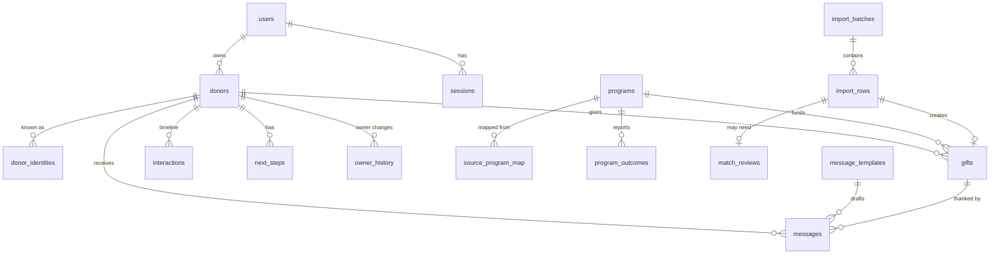

# CIC Compass: Data Model

PostgreSQL 16. SQLAlchemy 2.0 models in `backend/app/db/models/`, Alembic migrations in `backend/alembic/`. All ids are `bigint` identity unless noted. All timestamps are `timestamptz` (UTC); business dates (`gift_date`, `due_date`) are `date` interpreted in `America/Phoenix`. Money is integer cents. Soft delete via `deleted_at` where listed.

## 1. Entity overview



## 2. Tables

### 2.1 People and access

**users** (board members, including the super admin)
| Column | Type | Notes |
|---|---|---|
| id | bigint PK | |
| email | citext unique | login |
| display_name | text | shown as owner |
| password_hash | text | Argon2id |
| is_active | bool default true | deactivated users cannot log in |
| last_assigned_at | timestamptz null | round-robin tie-break |
| created_at, deactivated_at | timestamptz | |

**governance** (single row, `id = 1`, enforced by `CHECK (id = 1)`)
| Column | Type | Notes |
|---|---|---|
| super_admin_user_id | bigint FK users null | null = flat |
| super_admin_state | text CHECK in (`none`,`active`,`dormant`) | `none` iff user id null |
| reassign_scope | text CHECK in (`anyone`,`own_only`) | forced `anyone` unless state = `active` |
| updated_by, updated_at | | |

No foreign key `ON DELETE` path can remove the super admin: `users` rows are never hard-deleted (no DELETE grant in app role; repo has no delete function).

**sessions**: id, user_id, token_hash (unique), csrf_hash, created_at, last_seen_at, expires_at, revoked_at, ip, user_agent.

**invites**: id, email, token_hash (unique), created_by, created_at, expires_at, used_at.

**api_keys**: id, name, prefix (first 8 chars, for display), key_hash (unique), scopes text[], created_by, created_at, last_used_at, revoked_at.

**audit_log**: id, at, actor_kind (`user`,`api_key`,`cli`,`system`), actor_id, action (e.g. `import.commit`, `donor.reassign`, `message.send`, `gov.flatten`), entity, entity_id, data jsonb (no secrets, no message bodies), ip.

### 2.2 Donors

**donors**
| Column | Type | Notes |
|---|---|---|
| id | bigint PK | |
| kind | text CHECK in (`person`,`organization`,`funder`) | |
| display_name | text not null | |
| first_name, last_name | text null | persons |
| organization | text null | org name or employer |
| email | citext null | primary; contact detail (DON-3) |
| phone | text null | E.164 when parseable; contact detail |
| owner_user_id | bigint FK users null | null only while pending review |
| owner_assigned_at | timestamptz null | |
| do_not_contact | bool default false | |
| notes | text null | |
| created_via | text (`import`,`manual`,`merge`) | |
| created_at, updated_at, deleted_at | | |
| merged_into_id | bigint FK donors null | set on merge loser |
| custom | jsonb not null default `{}` | values keyed by `field_definitions.key` (CUS); `gifts.custom` is the same |

Indexes: `(owner_user_id) where deleted_at is null`, trigram index on `display_name` for search.

**donor_identities**: how we recognise a donor across sources.
| Column | Type | Notes |
|---|---|---|
| id | bigint PK | |
| donor_id | bigint FK donors | |
| kind | text CHECK in (`email`,`phone`,`zeffy_contact`,`benevity_donor`,`sheet_row`,`name_org`) | |
| value_norm | text | normalized (see 3.2) |
| source | text | where we learned it |
| created_at | | |

Unique `(kind, value_norm)` for `email`, `phone`, `zeffy_contact`, `benevity_donor`, `sheet_row`. `name_org` is not unique (used only to find review candidates).

**field_definitions** (CUS-1): id, entity CHECK in (`donor`,`gift`), key text (slug, immutable, unique per entity), label, type CHECK in (`text`,`long_text`,`number`,`money`,`date`,`bool`,`choice`,`multi_choice`), choices text[] null, is_builtin, is_required, is_contact (DON-3 applies), show_in_list, position, is_active default true, created_by, created_at, updated_at. Seeded with one row per built-in donor and gift field. Values live in `donors.custom` and `gifts.custom` (jsonb, GIN index).

**super_admin_nominations** (GOV-2): id, nominee_user_id, nominated_by, confirmed_by null, status (`pending`,`confirmed`,`cancelled`,`expired`), created_at, expires_at (72 h), decided_at.

**roles** (ROLE-1, Phase 5.5): id, name text unique, description text, permissions text[] (values from `authz.policy.Action`, grantable subset only), is_builtin bool, created_by, created_at, updated_at. Seeded: `Board member` (today's flat-mode set) and `Viewer`. **users.role_id** bigint FK roles not null, default Board member.

**owner_history**: id, donor_id, from_user_id null, to_user_id, changed_by (user id, null for system), method (`round_robin`,`manual`,`bulk`,`merge`), reason text null, changed_at.

### 2.3 Gifts and programs

**programs**: id, name unique, slug unique, is_active. Seed: AI Academy, K12 Program, Summer Camp, Day of Compute, General.

**source_program_map**: id, source, source_value_norm, program_id. Unique `(source, source_value_norm)`.

**gifts**
| Column | Type | Notes |
|---|---|---|
| id | bigint PK | |
| donor_id | bigint FK donors null | null = anonymous or pending review |
| attribution | text CHECK in (`linked`,`anonymous`,`pending_review`) | |
| source | text CHECK in (`zeffy`,`benevity`,`generic`,`manual`) | |
| source_platform | text null | for generic: `azgives`, `united_way`, other |
| source_txn_id | text null | platform's own id when present |
| row_key | text not null | see 3.1 |
| gift_date | date not null | |
| gross_cents | bigint CHECK (> 0) | |
| fee_cents | bigint default 0 | |
| net_cents | bigint | gross minus fee |
| currency | char(3) CHECK (= 'USD') | |
| program_id | bigint FK programs | default General |
| campaign_name | text null | raw value used for mapping |
| is_matching_gift | bool default false | |
| payer_name | text null | e.g. employer for Benevity |
| assumed_thanked | bool default false | ING-11 |
| import_batch_id | bigint FK null | |
| created_by | bigint FK users null | manual gifts |
| created_at, deleted_at | | |

Partial unique index: `UNIQUE (row_key) WHERE deleted_at IS NULL`.

**program_outcomes**: id, program_id, period_start date, period_end date, metric_label, value numeric, unit, source_note. For the funder export.

### 2.4 Import pipeline

**import_batches**: id, source, filename, file_sha256, uploaded_by, status (`previewed`,`committed`,`reversed`,`expired`), created_at, committed_at, reversed_at, cutoff_date, summary jsonb (counts and cents per class). Unique `(source, file_sha256) WHERE status = 'committed'`.

**import_rows**: id, batch_id, row_number, raw jsonb (the parsed row; dropped 30 days after commit), normalized jsonb, status (`new`,`already_imported`,`needs_review`,`invalid`,`donor_new`,`donor_matched`), reason text null, row_key, gift_id null, donor_id null.

Spreadsheet update proposals use the logical preview class `donor_update` and
summary bucket `donor_updates`; persisted rows retain `donor_matched`. No migration
is needed. Summary `updated_count` counts unique actually changed donors after
commit. Per-field preview baselines remain in the process-local preview cache;
`donor.import_update` audit data stores approved field names only (D-130).

**match_reviews**: id, import_row_id null, gift_id null, incoming jsonb (normalized fields), candidate_donor_ids bigint[], status (`open`,`linked`,`created_new`,`anonymous`), decided_by, decided_at.

### 2.5 Relationship work

**interactions**: id, donor_id, user_id, kind CHECK in (`call`,`text`,`email`,`meeting`,`note`,`thank_you`,`update`,`system`), occurred_on date, summary text, message_id null, gift_id null, created_at.

**next_steps**: id, donor_id, title, due_date, status (`open`,`done`,`cancelled`), created_by, created_at, done_at. Partial unique `(donor_id) WHERE status = 'open'` (one open step per donor).

**message_templates**: id, kind (`thank_you`,`quarterly_update`,`lapsed_nudge`,`event_invite`), channel (`email`,`sms`), subject, body, updated_by, updated_at.

**messages**
| Column | Type | Notes |
|---|---|---|
| id | bigint PK | |
| donor_id | bigint FK | |
| gift_id | bigint FK null | for thank-yous |
| kind | as templates | |
| channel | `email` / `sms` | |
| status | CHECK in (`draft`,`approved`,`sent`,`sent_manually`,`cancelled`,`failed`) | |
| subject, body | text | |
| body_sha256_at_approval | text null | |
| created_by, approved_by, sent_by | bigint FK users null | |
| created_at, approved_at, sent_at | | |
| delivery_mode | `dry_run` / `live` / `manual` null | |
| provider_ref, error | text null | |

Database checks:
- `status IN ('sent') → approved_by IS NOT NULL AND approved_at IS NOT NULL AND sent_at IS NOT NULL`
- `status = 'approved' → approved_by IS NOT NULL AND body_sha256_at_approval IS NOT NULL`
- Partial unique `(donor_id, kind) WHERE status IN ('draft','approved') AND kind <> 'thank_you'`, and `(gift_id) WHERE kind = 'thank_you' AND status IN ('draft','approved')` (MSG-2 idempotency).

**digest_runs**: id, triggered_by, run_at, mode, recipients int, details jsonb (per user: reminder counts only).

**app_settings**: key text PK, value jsonb. Keys: `thank_you_days_first` (2), `thank_you_days_repeat` (7), `quarterly_days` (90), `import_cutoff_days` (60), `retention_basis` (`rolling`), `auto_thank_you` (false, MSG-9), `quarterly_board_email` (false, REM-9).

**job_runs**: id, job text (`auto_thank_you`,`quarterly_board_email`), started_at, finished_at, status (`ok`,`failed`,`skipped`), counts jsonb (no donor data), error text null. Written by `python -m app.cli run-job <job>`, which the Render cron calls.

## 3. Rules

### 3.1 Gift `row_key` (DED-2)

```
if source_txn_id present:
    row_key = sha256("v1|" + source + "|" + source_txn_id)
else:
    base = "v1|" + source + "|" + source_platform + "|" + donor_key + "|" + gift_date + "|" + gross_cents
    row_key = sha256(base + "|" + occurrence)
```
- `donor_key` = normalized email, else normalized platform donor id, else normalized full name, else `anon`.
- `occurrence` = 1, 2, 3 for identical `base` tuples **within one file**, so two genuine identical $50 gifts on the same day stay two gifts, and re-uploading the same file gives the same keys.
- Known limit (documented in IMPORT_FORMATS.md): a file without transaction ids split so that identical gifts land in different files can under-count. Zeffy and Benevity both provide transaction or disbursement ids, so this affects the generic template only.

### 3.2 Normalization

- Email: trim, lowercase; Gmail dots and `+tags` are **not** removed (would cause wrong merges).
- Phone: digits only; US 10-digit gets `+1`; anything else stored as digits.
- Name: Unicode NFKC, lowercase, strip punctuation and honorifics (mr, mrs, ms, dr), collapse spaces.
- Names conflict when both have last names and the normalized last names differ, or first initials differ.
- Money: parse `$1,234.50`, `1234.5`, `(12.00)` (negative, rejected as invalid for gifts); round half up to cents.
- Dates: ISO, `MM/DD/YYYY`, `M/D/YY`, Excel serials; anything else invalid.

### 3.3 Round-robin (OWN-2)

```sql
-- inside the commit transaction
SELECT pg_advisory_xact_lock(4201);           -- serialize assignment
SELECT u.id
FROM users u
LEFT JOIN donors d ON d.owner_user_id = u.id AND d.deleted_at IS NULL
WHERE u.is_active
GROUP BY u.id
ORDER BY count(d.id) ASC, u.last_assigned_at ASC NULLS FIRST, u.id ASC
LIMIT 1;
-- assign, set users.last_assigned_at = now(), insert owner_history(method='round_robin')
```
Repeat per new donor in a stable order (by first gift date, then display name) so results are deterministic.

### 3.4 Reminders (derived, REM-1 to REM-4)

Implemented as SQL in `backend/app/services/reminders.py`, one query per type, all parameterized by `today` from the injected clock.

- **thank_you_due**: gifts `g` where `g.attribution = 'linked'`, not `assumed_thanked`, not deleted, no message `m` with `m.gift_id = g.id AND m.status IN ('sent','sent_manually')`, no interaction kind `thank_you` with `gift_id = g.id`; due = `gift_date + (first gift of donor ? thank_you_days_first : thank_you_days_repeat)`. Shown when `due <= today + 2`.
- **quarterly_due**: donors not deleted, not do_not_contact, where `greatest(last sent message date, last interaction date, donor created date) < today - quarterly_days`. (Donor created date stops a brand-new import from flagging every donor on day one; backfilled donors get `created_at` from the import.)
- **next_step_due**: open next steps with `due_date <= today + 3`.
- **needs_reassignment**: donors whose owner `is_active = false`.

Each reminder row: `type, donor_id, owner_user_id, due_date, gift_id null, next_step_id null`. The To-do list filters by `owner_user_id = me`, plus all `needs_reassignment` rows.

### 3.5 Retention (RPT-2)

For as-of date `T`: current window `(T-365, T]`, previous `(T-730, T-365]`. Per donor (linked gifts only, excluding `is_matching_gift` per D-127): `cur`, `prev`, and `ever_before = any employee donation <= T-730`. Donor lifetime and 12-month giving use the same exclusion. Org gross/net revenue still includes employer matches; donor linkage on a match is traceability, not employee credit. Message merge amounts must use employee donations only; a match must never supply a pre-filled donor amount.
- new: `cur > 0, prev = 0, not ever_before`
- reactivated: `cur > 0, prev = 0, ever_before`
- increased / same / decreased: `cur > 0, prev > 0`, compare cents
- lapsed: `cur = 0, prev > 0`

### 3.6 Visibility (DON-2 to DON-4) in one policy module

`backend/app/authz/policy.py` exposes `can(actor, action, resource) -> bool`. Repos call it; routes never decide on their own. Contact fields are removed in the response serializer when `not can(actor, "donor.view_contact", donor)`.

| Action | Owner | Other member | Active super admin |
|---|---|---|---|
| donor.view (history, timeline) | yes | yes | yes |
| donor.view_contact | yes | no | yes |
| donor.act (log, next step, draft, approve, send) | yes | no | yes |
| donor.edit | yes | no | yes |
| donor.reassign | yes | scope `anyone` only | yes |
| import, review decisions | yes (any member) | yes | yes |
| settings, templates, programs, invites, api keys | flat: any member; active SA: SA only | | |
| digest.send | flat: any member; active SA: SA only | | |
| gov.flatten | no | no | yes |

## 4. Fixtures (synthetic only)

`fixtures/generate.py` (deterministic seed) writes:
- `synthetic_cic_spreadsheet.xlsx`: ~120 donors and 6 funders, typos, shared household emails, missing emails.
- `synthetic_zeffy_like.csv`: ~400 payments over 30 months, campaigns that map to programs, monthly recurring donors, refunds absent.
- `synthetic_benevity_like.csv`: ~80 rows across 6 disbursements, employer match rows, 10 anonymous rows, donors overlapping Zeffy with different emails.
- `synthetic_generic_azgives_like.csv`: ~40 rows in the generic template.
- `manifest.json`: expected counts and cents per class, expected review items, expected retention classes as of `DEMO_NOW`.

Column choices follow `docs/IMPORT_FORMATS.md`. Never claim a fixture is a real platform format.
