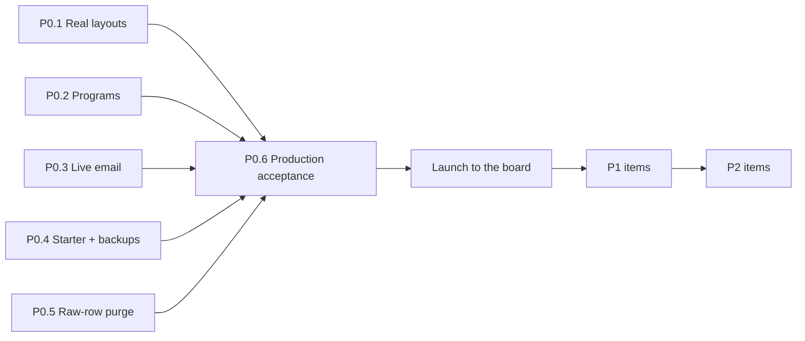

# Roadmap and handoff

Where CIC Compass stands after the hackathon weekend (November 15, 2026), what is missing, and how Coding in Color can take it to everyday use.

**Contents:** [Current status](#current-status) · [Known limitations](#known-limitations) · [Path to completion](#path-to-completion) · [Handoff plan for Coding in Color](#handoff-plan-for-coding-in-color) · [Open questions](#open-questions) · [Maintenance](#maintenance)

## Current status

"Done" means built, tested in CI and usable from the web app. "API only" means the backend works and is tested, but no screen calls it yet.

| Area | Status | Notes |
|---|---|---|
| Sign-in, sessions, CSRF, rate limits, security headers | Done | Argon2id, hashed session tokens, audited |
| Members, invites, deactivation | Done | Deactivated members' donors surface as "Needs reassignment" |
| Governance: flat board, optional super admin | Done | Nominate + confirm by two members; removal returns to flat; break-glass CLI |
| Import: spreadsheet, Zeffy, Benevity, generic | Done | Layouts assumed from public docs ([DATA.md](DATA.md#assumptions)) |
| De-duplication and review queue | Done | Household, phone-only and name-conflict cases go to Review |
| Anonymous gift attribution | Done | From the Review screen |
| Import batch history and reversal | API only | `POST /imports/{id}/reverse` works; no button yet |
| Round-robin ownership, reassignment, owner history | Done | |
| To-do reminders (thank-you, quarterly, next step) | Done | Derived from data, never stored |
| Donor directory and dossier, manual entry, contact log, next steps | Done | Contact details owner-only |
| Custom fields on donors and gifts | Done | Add, rename, reorder, hide, deactivate; import columns fill them |
| Messages: templates, drafts, approve, send, text + mark sent | Done | Email in dry run until a provider is configured |
| Quarterly bulk drafts | Done | "Draft quarterly updates for my due donors" |
| Reports: summary and retention | Done | Rolling or calendar year, donor drill-down |
| Funder packet (HTML and CSV) | Done | Links on the donor page; CSV formula-safe |
| Lapsed-donor radar with drafted nudges | API only | `GET /reports/lapsed`, `POST /reports/lapsed/draft` |
| Reminder digest email to board members | API only | `POST /digest/send` (dry run by default) |
| Program outcomes | API only | Upload and list endpoints; used by the funder packet |
| Programs and campaign-to-program map | Not started | Endpoints are 501 stubs; seeded programs are used |
| App settings screen (thresholds, assistant switch) | Not started | `GET/PUT /settings` are 501 stubs; values live in `app_settings` |
| Donor merge | Not started | `POST /donors/{id}/merge` is a 501 stub |
| Board-member column on imports (ING-13) | Not started | New donors are assigned round-robin |
| Assistant (sentence → proposed actions) | Done, off by default | Needs AI gateway settings and `assistant_enabled` |
| Read API `/api/v1`, API keys, full-access keys | Done | Aggregate-only public API, tested for no PII |
| MCP server | Done | Six read-only tools |
| Branded sign-in landing page | Done | Brand rules in [BRAND.md](BRAND.md) |
| Deployment | Done | Render free plan + Neon; live at <https://cic-compass.onrender.com> |

## Known limitations

- **Import previews live in memory** for 20 minutes in one process, so the app must run as a single process, and a restart means uploading again.
- **Generic files without transaction ids:** two identical gifts split across two different files can be counted once ([DATA_MODEL.md](DATA_MODEL.md)). Zeffy and Benevity files carry ids.
- **Layouts are assumed** until CIC shares real header rows (A1 in [DATA.md](DATA.md#assumptions)).
- **Raw import rows are not purged** after 30 days as designed; the clean-up job is missing.
- **Gift notes are refused** on manual gifts, because gift history is visible to every member and a note could hold personal details.
- **Rate limits are per process** and reset on restart (D-128).
- **Free hosting sleeps:** the first visit after 15 idle minutes takes about a minute.
- **Lighthouse and the full end-to-end acceptance run on production** were not recorded before the deadline.

## Path to completion

**P0: needed before CIC relies on it**

| # | Step | Why | Effort | Depends on |
|---|---|---|---|---|
| 1 | Verify import layouts with one real export per source | Real files may differ from public docs | 0.5 day | CIC sends header rows |
| 2 | Programs and program-map screens and endpoints | Correct per-program reports and funder packets | 1 day | CIC's program list |
| 3 | Live email: verify CIC's sending domain in Resend, set `MESSAGING_MODE=live` | Thank-yous actually reach donors | 2 hours | CIC domain access |
| 4 | Move hosting to Render Starter and set up regular database backups | Always on, recoverable | 2 hours | CIC billing account |
| 5 | Purge raw import rows after 30 days | Data minimization for real donor data | 0.5 day | none |
| 6 | Run the acceptance tests and Lighthouse on production; fix findings | Confidence before launch | 1 day | steps 1 to 4 |

**P1: important**

| # | Step | Effort | Depends on |
|---|---|---|---|
| 7 | Board-member column on imports (ING-13) | 1 day | none |
| 8 | Screens for lapsed-donor radar, reminder digest and batch reversal | 1 to 2 days | none |
| 9 | Settings screen (reminder thresholds, import cutoff, assistant switch) | 1 day | none |
| 10 | Donor merge with ownership rules (DED-7) | 1 to 2 days | none |
| 11 | Shared rate limits and preview storage, so the app can run more than one process | 1 day | step 4 |

**P2: nice to have** (from the SRS improve-later list)

- Zeffy API pull job instead of manual Zeffy uploads.
- Events-aware next steps (Day of Compute, camps) with drafted invites.
- AI-drafted updates from donor history, behind a setting, always human-approved.
- Milestone and holiday touch reminders; dashboard charts.
- Custom roles and permissions; custom fields on programs and members.
- Optional frontend hosting on Vercel (D-140).

*Notice that the P0 steps are independent of each other and can be done in parallel; production acceptance is the only gate before launch.*

## Handoff plan for Coding in Color

**What CIC needs to provide**

1. One exported header row (or a single anonymized row) from Zeffy payments, Benevity disbursements and the donor spreadsheet.
2. The program list and how campaigns map to programs (A3), and CIC's fiscal year (A4).
3. Board member names and emails for the first `setup` run.
4. Access to transfer accounts: the GitHub repository, Render service, Neon project and a Resend account with CIC's sending domain.
5. Decisions on the open questions below.

**Stakeholders:** CIC's executive director and board members (daily users), whoever manages CIC's Zeffy and Benevity accounts (data owner), and a volunteer or contracted developer who maintains the app.

**What success looks like:** every board member signs in weekly, imports run from real exports without manual cleanup, every gift is thanked within a week, and the board reviews retention each quarter.

**Suggested timeline**

| When | Milestone |
|---|---|
| Week 1 | Accounts transferred; real layouts verified (P0.1); programs entered (P0.2) |
| Week 2 | Live email and Starter hosting with backups (P0.3, P0.4); raw-row purge (P0.5) |
| Week 3 | Production acceptance run (P0.6); board onboarding session |
| Month 2 and later | P1 items in order of what the board asks for first |

## Open questions

| For | Question |
|---|---|
| CIC | What are the exact column headers in your Zeffy and Benevity exports? |
| CIC | Which programs should exist, and how do Zeffy campaigns map to them? Six programs (from CIC's one-pager) or the five seeded ones? |
| CIC | Calendar or fiscal year for reports? |
| CIC | Should contact details be visible to every board member, or only to a donor's owner (current default)? |
| CIC | Which domain should email come from? |
| CIC | What will the board-member column in your spreadsheet be called? |
| Organizers | Does an internal reminder email to board members count as a message a human must send? (Default: a person clicks Send digest.) |

## Maintenance

- **Checks:** run the commands in [SETUP.md](SETUP.md#tests-and-checks); CI runs them on every push and pull request.
- **Deploy:** merge to `main`; Render rebuilds and runs migrations on start ([DEPLOY.md](DEPLOY.md)).
- **Database changes:** add an Alembic migration in `backend/alembic/versions/`, regenerate the API types (in `backend/`: `uv run python -m app.export_openapi ../frontend/src/api/openapi.json`; then in `frontend/`: `npm run gen:api`), and commit both.
- **Rotate secrets:** reset the Neon password and update `DATABASE_URL` in Render; rotate `RESEND_API_KEY` in Resend and Render; revoke API keys with `uv run python -m app.cli apikey revoke <id>` or on Settings → API keys.
- **Where credentials live:** Render's environment settings and each developer's local `.env`. Never in the repository; CI runs a secret scan.
- **Super admin recovery:** `uv run python -m app.cli superadmin {create,activate,transfer,flatten,deactivate}` against the database ([DEPLOY.md](DEPLOY.md#break-glass-the-setup-command)).
